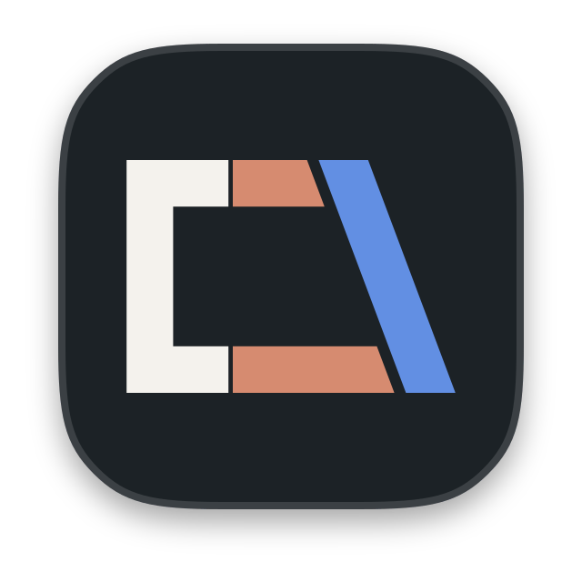

<p align="center">
  
</p>

# CodClaw NTR
<p align="right">
    <strong>English</strong> | <a href="./README/README_CN.md">中文</a>
</p>

[](https://opensource.org/licenses/Apache-2.0)

> *"Who says you can't have your cake and eat it too?"*
>
> — an old English proverb, turned around

CodClaw NTR is a fork of OpenAI's Codex CLI that runs on the configuration you already keep for Claude
Code: your `CLAUDE.md` files, rules, skills, hooks, settings, subagents and MCP servers are read in
place, so one setup serves both tools and an edit in `~/.claude` reaches Codex at its next request.

NTR stands for Native Tooling Ready: Claude Code's native configuration works as it is, with nothing to
convert or migrate.

## Table of Contents

- [Overview](#overview)
- [Scope](#scope)
- [Features](#features)
- [What Is Not Compatible](#what-is-not-compatible)
- [Installation](#installation)
- [Usage](#usage)
- [Docs](#docs)
- [Disclaimer](#disclaimer)
- [License](#license)
- [Author](#author)

## Overview

CodClaw NTR keeps Codex itself (its models, sandbox, approvals, TUI and IDE extension) and adds a
compatibility layer that reads Claude Code's files where Claude Code keeps them. Nothing is copied or
converted: there is no sync step, and `CCN_CLAUDE_COMPAT=0` turns the whole layer off. Where Codex
already has a mechanism, the layer hands the work to it; it only adds what Codex lacks. The details,
item by item, are in [Claude Code compatibility](./docs/claude-compat.md).

<!-- compat-progress -->
<!-- Generated by scripts/compat-progress.py from docs/claude-compat.md; do not edit. -->
<p></p>

Of the 419 Claude Code features planned: **30.1%** fully compatible (126), **36.8%** partly compatible (154, each difference written down), **33.1%** not started yet (139). The grey end of the bar is the 19 features not planned (they contradict Codex's core), drawn in proportion to all 438 and left out of the percentages.
<!-- /compat-progress -->

The fork's own settings live in `~/.codex/ccn-config.toml`, never in Codex's `config.toml`.

## Scope

CodClaw NTR is Codex made to read Claude Code's configuration files as completely as it can. What that
means for the code:

- **Claude Code compatibility comes first.** Where Codex conflicts with Claude Code's configuration,
  Codex is changed to follow Claude Code, even when the change is large.
- **Otherwise Codex stays as it is.** Codex's own features that do not conflict are kept, though keeping
  them is not a goal in itself. Codex's code is changed no more than compatibility needs, so that upstream
  Codex's updates keep coming in: the fork may drift from upstream, but never so far that a merge can't be
  resolved by hand.
- **Plugins and settings stay Codex's.** The plugin system and the program's settings are core parts of
  Codex and hard to change much, and rebuilding Claude Code's plugin system here would serve no purpose.
  Claude Code's plugins are supported where that is easy; the settings are Codex's `config.toml` and this
  fork's `ccn-config.toml`, and of Claude Code's settings only what the compatibility needs is read.

For a harness that goes all the way to Claude Code's ecosystem, see
[jjcn](https://github.com/SotA-Harness-Lab/jumbo-jet-cod-claw-ntr), which is built on this one.

## Features

- **Instructions**: `~/.claude/CLAUDE.md`, project `CLAUDE.md`, `.claude/CLAUDE.md` and
  `CLAUDE.local.md` with `@` imports, and the rules under `.claude/rules`. Rules limited by `paths:` and
  the `CLAUDE.md` files of nested directories are shown once a file they cover is read or edited.
- **Skills**: `~/.claude/skills` and each project's `.claude/skills`, with Claude Code's frontmatter
  (`disable-model-invocation`, `when_to_use`, `arguments`). In the TUI, `/<skill-name> <args>` invokes a
  skill with `$ARGUMENTS`, `${CLAUDE_SKILL_DIR}` and the other substitutions.
- **Hooks**: the hooks of `settings.json` run as they do in Claude Code, including `Notification`,
  `PostToolUseFailure` and `StopFailure`, with Claude Code's tool names and input; a `PreToolUse` hook
  may allow a call, ask about it or block it.
- **Settings**: `env` is added to the commands' environment; Bash permission rules become Codex command
  rules.
- **Auto memory**: the project's `MEMORY.md` is loaded, and Codex writes new memories where and how
  Claude Code does, so both tools share one memory.
- **Custom slash commands**: `~/.claude/commands`, a project's `.claude/commands` and plugins'
  `commands/` are loaded in place as skills, named after their path (`git/commit.md` is
  `/git:commit`, a plugin's `/<plugin>:<command>`).
- **Subagents**: `~/.claude/agents/*.md` and a project's `.claude/agents` become agent roles.
- **MCP servers**: those of `~/.claude.json` and approved `.mcp.json` files.
- **Plugins**: the plugins enabled in Claude Code are loaded in place; one that relies on a mechanism
  Codex does not have (such as Claude Code's status line) is disabled, unless `ccn-config.toml` enables
  it.
- **Claude Code's tool set** (optional, `[claude] tools = true` in `ccn-config.toml`): `Bash`, `Read`,
  `Write`, `Edit`, `Glob`, `Grep`, `WebFetch`, `WebSearch`, `TodoWrite`, `AskUserQuestion` and `Agent`
  replace Codex's tools, as a layer over them, and `Skill` lets the model invoke a skill with arguments. Permission rules (`Read(...)`, `Edit(...)`,
  `WebFetch(domain:...)`), subagent `tools` and hook matchers then match Claude Code one to one.
  As in Claude Code, a `cd` in `Bash` carries over to the next command while it stays inside the
  project, and `Read` shows notebooks cell by cell and PDFs page by page (PDFs need poppler-utils:
  `pdftoppm`, `pdftotext`, `pdfinfo`).

## What Is Not Compatible

- `defaultMode` and `additionalDirectories` of `permissions`, managed (enterprise) settings, output
  styles and the status line: Codex has no counterpart.
- Skill bodies' shell injection (`` !`command` ``), and substitutions in a skill the model opens by
  itself rather than through `/<name>`.
- Claude Code's own models and account: CodClaw NTR talks to the models Codex supports.
- Windows: this fork builds for macOS and Linux only.

## Installation

CodClaw NTR has no release yet; build it from source.

### Building from Source

See [Installing & building](./docs/install.md). In short, with Rust installed:

```shell
cd codex-rs
eval "$(bash ../scripts/fetch-rusty-v8.sh)"
cargo build --release -p codex-cli --bin ccn
cargo build --release -p codex-code-mode-host
```

`scripts/fetch-rusty-v8.sh` downloads the prebuilt V8 that the build links against.

## Usage

Run `ccn` in a project. It signs in like Codex: choose **Sign in with ChatGPT**, or set up an API key as
described in [Codex's authentication docs](https://developers.openai.com/codex/auth#sign-in-with-an-api-key).

A build from source has no background server package: start the TUI with `ccn --no-daemon`.

To use Claude Code's tool set, create `~/.codex/ccn-config.toml`:

```toml
[claude]
tools = true
```

## Docs

- [**Claude Code compatibility**](./docs/claude-compat.md)
- [**Codex Documentation**](https://developers.openai.com/codex)
- [**Contributing**](./docs/contributing.md)
- [**Installing & building**](./docs/install.md)
- [**Open source fund**](./docs/open-source-fund.md)

## Disclaimer

This project is not affiliated with, endorsed by, or sponsored by OpenAI. "Codex" is a trademark of OpenAI and is referenced here solely for descriptive purposes.

This project is not affiliated with, endorsed by, or sponsored by Anthropic. "Claude" and "Claude Code" are trademarks of Anthropic and are referenced here solely for descriptive purposes.

## License

Copyright 2026 Tianyu (Sky) Lu

Except for the third-party code listed below, this repository is 
licensed under the Apache License, Version 2.0 (the "License"); you may 
not use these files except in compliance with the License. You may 
obtain a copy of the License at

```plaintext
http://www.apache.org/licenses/LICENSE-2.0
```

Unless required by applicable law or agreed to in writing, software
distributed under the License is distributed on an "AS IS" BASIS,
WITHOUT WARRANTIES OR CONDITIONS OF ANY KIND, either express or implied.
See the License for the specific language governing permissions and
limitations under the License.

### Third-Party Code

This repository includes the following third-party code, which remains under its respective original licenses:

| Code | Included As | License | Copyright | Modified |
|------|-------------|---------|-----------|----------|
| [Codex](https://github.com/openai/codex) | Forked from | [Apache-2.0](LICENSES/Codex-Apache-2.0.txt) | Copyright 2025 OpenAI | Yes |
| [bubblewrap](https://github.com/containers/bubblewrap) | Vendored in `codex-rs/vendor/bubblewrap` | [LGPL-2.0-or-later](codex-rs/vendor/bubblewrap/COPYING) | Copyright (C) 2016 Alexander Larsson | No |

All other code in this repository, including changes made to the code 
above, is licensed under the Apache License, Version 2.0. The commit history of 
this repository, together with snippets and file headers marked in the 
source files, identifies which code belongs to which project. Files that 
contain code from more than one project are subject to all applicable 
licenses. Contributions to this repository are accepted only under the 
Apache License, Version 2.0 ("inbound = outbound" principle).

## Author

Tianyu (Sky) Lu
